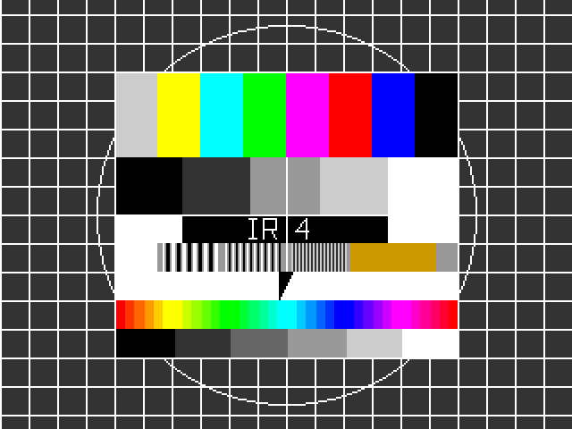
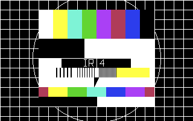
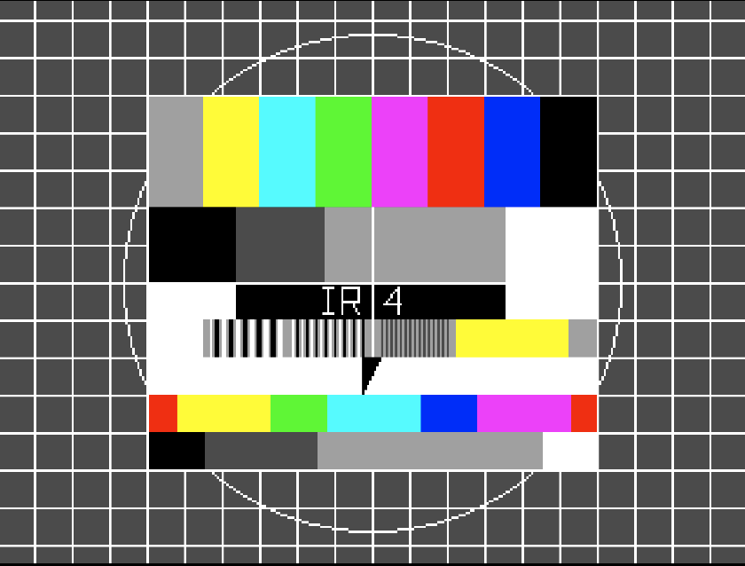
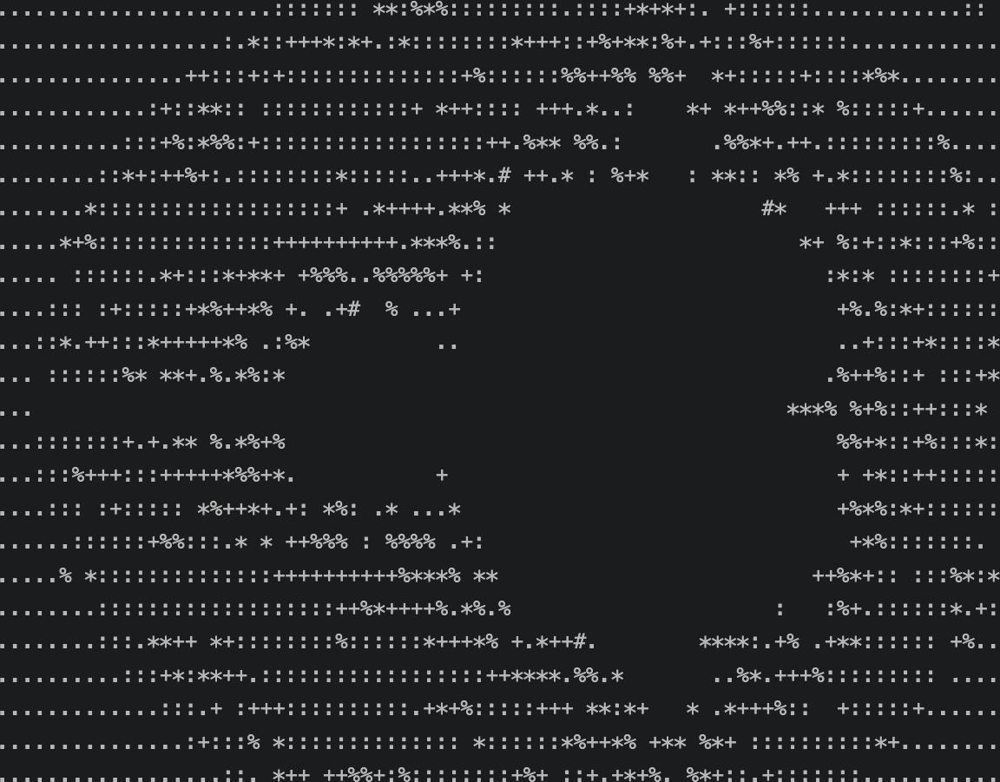
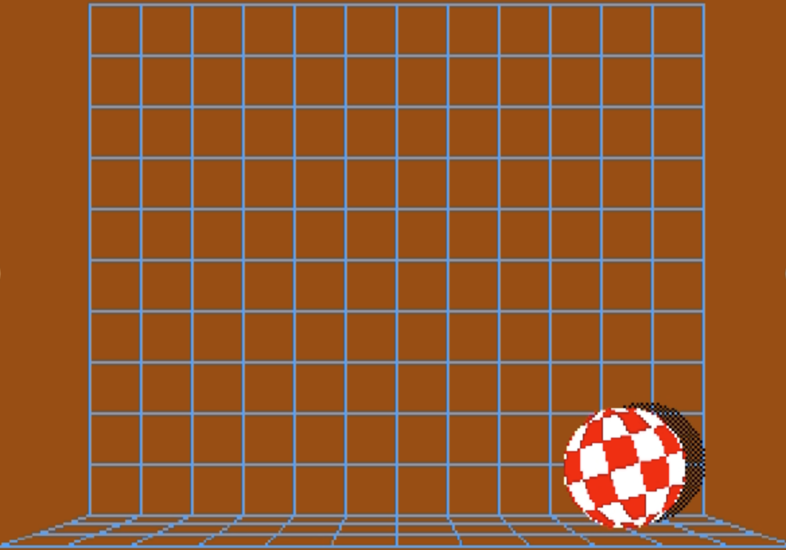

# IR4(th)

**IR4(th)** (*Typed Forth as an Intermediate Representation*) is a minimal, statically typed, monomorphic concatenative intermediate language designed for retro-computing CPUs (such as Z80 and 6502) and constrained embedded systems.

IR4(th) programs are compiled via a 2-pass direct machine-code compiler (with reachability dead-code elimination) using `ir4c` (written in strict C89).

See [spec.md](spec.md) for the full language specification.

This project is based on [hi5](https://github.com/stefanhaustein/hi5), an earlier IR stack language prototype implemented in KMP with Z80 support.


## Examples

Hello world ([examples/hello.ir4](examples/hello.ir4)):

```forth
require "stdio.ir4"

data msg
  "Hello, world!\n" 0 :i8
end

fn main ( -> :i )
  msg type0
  0
end
```

Typed memory loop & recursion ([tests/fib.ir4](tests/fib.ir4), [lib/mem.ir4](lib/mem.ir4)):

```forth
fn fib ( n :i -> :i )
  n 2 < if n return then
  n 1 - fib n 2 - fib +
end
```

See [examples/](examples/) for more code examples and [tests/](tests/) for the full test suite.


## Runtime Library

IR4(th) includes a minimal portable runtime library in [lib/](lib/).

It uses `require` with a platform → architecture → generic fallback chain (`lib/<platform>/` → `lib/<arch>/` → `lib/`).

The runtime library outside of stdio should be considered as a placeholder for experimentation
and is not supposed to replace the runtime library of the frontend language.

In particular, the graphics library is aimed at simplicity and portability rather
than performance or completeness. Platform graphics modi or other features that seemed 
inconvenient to support might be missing. 

See [docs/lib.md](docs/lib.md) for the full Runtime Library API reference.


## Compiler Optimizations

- **Dead-code elimination:** Only functions reachable from `main` and `init` blocks are emitted.
- **Constant folding & casts:** Compile-time folding for integer arithmetic/comparisons and literal casts (`:a`, `:i32`, `:u32`).
- **Strength reduction:** Power-of-2 `*`, `u/`, and `umod` by constants lower to shifts (`<<`, `u>>`) and masks (`and`); multiply/unsigned-divide by `1` is elided.
- **Immediate lowering:** Constant-operand `+`/`-`, comparisons, shifts, and base+offset memory accesses emit immediate instructions where supported by the target.
- **Static locals (Z80 / eZ80 / 6502):** Non-recursive functions place locals in static RAM rather than frame-pointer stacks.
- **On-demand runtimes:** Math, `:i32`, and floating-point helpers are embedded only when referenced.


## Building & Testing

```sh
make              # Build build/ir4c (C89)
make test         # Compile tests for Z80, 6502, ARM64 and run ARM64 JIT tests
make test-rv32    # Build QEMU virt ELF32 binaries and run them via qemu-system-riscv32 (if installed)
make test-6502    # Build sim65 binaries and run them via sim65 (if installed)
make test-z80     # Build CP/M .com binaries and run them via tnylpo (if installed)
make test-ez80    # Build Agon MOS binaries and run them via fab-agon-emulator (if installed)
```

## Usage

Compile with `ir4c`:

```sh
./build/ir4c [-t z80|ez80|6502|arm64|rv32|bc|cpm|zx81|agon|sim65|c64|x16|x16-cart|virt|obj] [-b hex_addr] [-o out.bin] [-I dir] [--platform name] [--zp hex_addr] [--stack-zp hex_addr[:init_x]] [--no-stack-zp] [--run] <input.ir4>
```

Pass `-I dir` (repeatable) to add library search directories ahead of the built-in `lib/` directory.


## Targets

- **Z80** (`-t z80`): Generates Z80 machine code, with [`-t cpm`](docs/cpm/) for CP/M `.com` executables and [`-t zx81`](docs/zx81/) for Sinclair ZX81 `.p` snapshots.
- **eZ80** (`-t ez80`): Generates 24-bit eZ80 ADL machine code, with [`-t agon`](docs/agon/) for Agon Light / Console8 MOS executables.
- **6502** (`-t 6502`): Generates 6502 machine code (configurable `--zp`, `--stack-zp`, `--no-stack-zp`), with `-t sim65` for `cc65`'s `sim65` simulator, [`-t c64`](docs/c64/) for Commodore 64 `.prg`, and [`-t x16` / `-t x16-cart`](docs/x16/) for Commander X16 `.prg` and banked `.crt` cartridges.
- **ARM64** (`-t arm64`): Generates AArch64 machine code, with `--run` support for direct JIT execution on macOS Apple Silicon.
- **RISC-V RV32IM** (`-t rv32`): Generates RV32IM machine code, with `-t virt` for standalone QEMU `virt` ELF32 execution and `-t obj` for relocatable ELF32 `.o` output (linking `extern` symbols and `libgcc` soft-float).
- **Bytecode VM** (`-t bc`): Emits portable IR4th bytecode, with `--run` to execute directly in the built-in stack VM.


## Repository Layout

- [src/](src/) — Compiler frontend, code buffer, and target backends
- [lib/](lib/) — Standard library and platform overrides
- [examples/](examples/) — Standalone example programs
- [tests/](tests/) — Cross-target test suite and negative compiler tests in [tests/errors/](tests/errors/)
- [tools/](tools/) — Relocatable runtime generators and developer tools
- [docs/](docs/) — Platform documentation and screenshots
- [spec.md](spec.md) — IR4(th) language specification

## Screenshots

| Target | Mandelbrot ([mandel.ir4](examples/mandel.ir4)) | TV Test Card ([testcard.ir4](examples/testcard.ir4)) |
|---|---|---|
| **Commander X16** |  |  |
| **Commodore 64** |  |  |
| **Agon** |  |  |
| **CP/M** |  | — |
| **Sinclair ZX81** |  | — |
| **Terminal (ANSI half-blocks)** |  |  |


## Videos

[](https://www.youtube.com/watch?v=H2avVT9lBHs)

## License

Licensed under the **GNU General Public License v3.0 or later (GPLv3+)** with a compiled-output exception and separate notices for third-party float runtimes (`math48` and `wozfp`). See [LICENSE](LICENSE) (and [GPLv3](GPLv3) for the full GPLv3 text).
